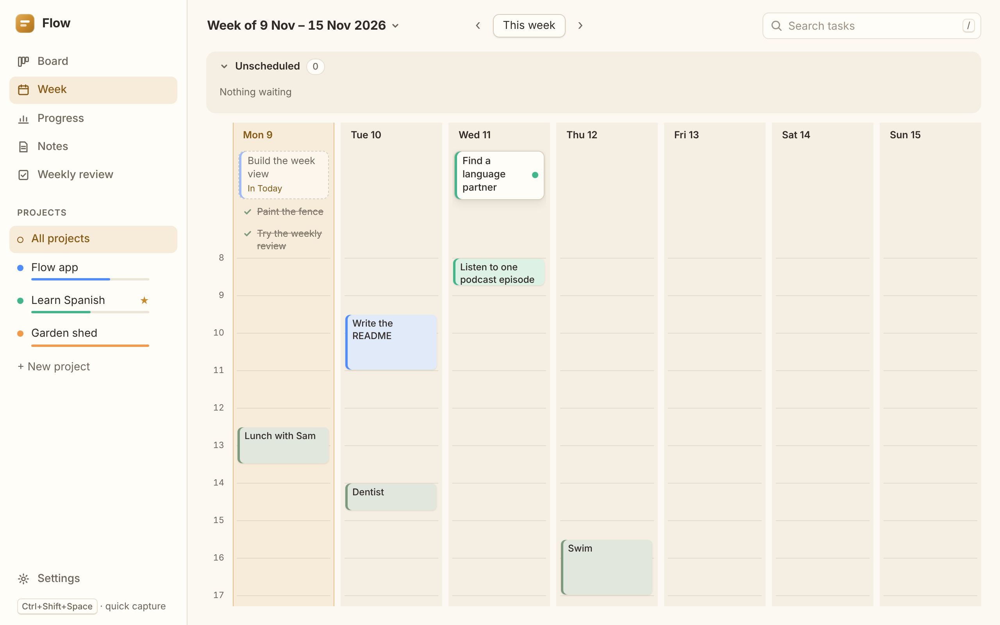
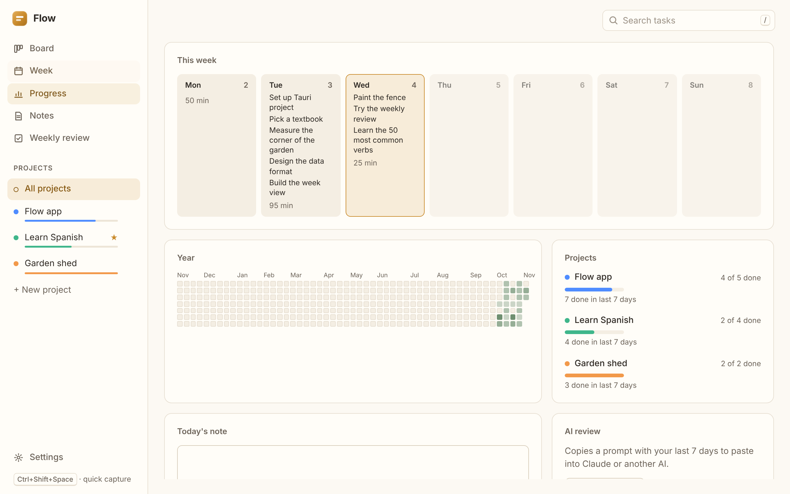
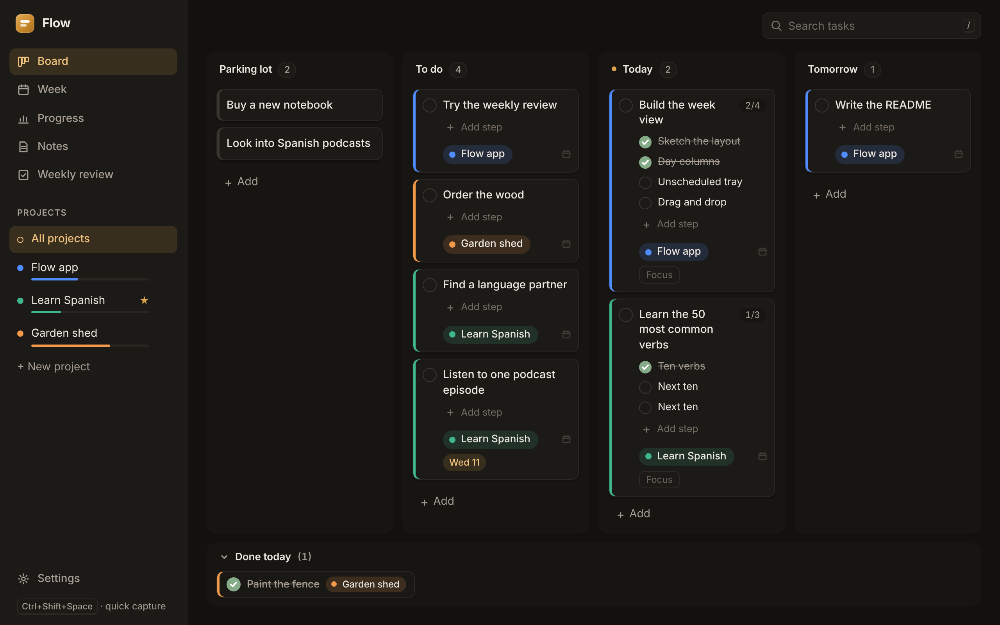

# Flow

Flow is a calm desktop planner for one person, built to help you stay with one thing at a time.
Everything you enter is stored as plain Markdown files in a folder you choose, so you (or an
AI assistant) can read and edit them any time. Nothing is sent anywhere unless you press one
of the Claude buttons (see below).


## What you can do

- **Board.** Five columns: **Parking lot** (loose thoughts), **To do**, **Tomorrow**, **Today**
  and **Done**. Drag cards between columns and tick them off. Drop a task on the Parking lot to
  park it (its first step, steps and planned day are kept in the note). Tasks in Tomorrow move to
  Today by themselves the next morning.
- **Plan a task in two clicks.** The small calendar button on a card offers Today, Tomorrow, the
  next few days, next week or any date. A new task can get a "Plan for" date right away.
- **Focus on one project.** Click a project in the sidebar to see only its cards, with its goal,
  a progress bar and how much you finished this week. Edit the goal and the project notes in
  place, and add short dated decisions.
- **Focus timer.** Press **Focus** on a Today card to start a quiet 15, 25 or 45 minute timer.
  When it ends, nothing pops up; the bar at the top just offers "Mark done" or "Another round".
  Finished sessions are logged so you can see your focus time.
- **Checklists.** Break a task into steps. The card shows `2/5` and the next step to do.
  Drag a step by its grip to reorder it (or focus the grip and press Alt+Up / Alt+Down).
- **Plan your week.** The **Week** view has seven day columns and an Unscheduled tray. Drag a
  task onto a day. When that day comes, the task moves to Today by itself.
  You can move any task freely, Today tasks too; dropping one on a past day marks it done that day.
- **Weekly review.** A short guided review: what you finished, what is unfinished (keep, push to
  next week, send back or delete), a project to focus on next week, and a few words of reflection.
  It is saved in your folder and the chosen project gets a star in the sidebar next week.
- **Progress.** This week by day, a year heatmap of finished tasks, progress per project and a
  note for today. There are no streaks: Flow never counts consecutive days.
- **Notes.** A big, quiet place for general notes and for each project's notes.
- **Claude built in (optional).** See the section below.
- **Light and dark** theme, following your system.







## Keyboard shortcuts

They work when you are not typing in a text field.

| Key | What it does |
| --- | --- |
| `/` | Search tasks |
| `n` | New task in To do |
| `b` | Board |
| `w` | Week |
| `p` | Progress |
| `o` | Notes |
| `r` | Weekly review |
| Ctrl+Shift+Space | Quick capture into the Parking lot, from any app (Cmd+Shift+Space on Mac) |

## Claude built in

Flow can ask Claude (made by Anthropic) to **review your week** and to **plan tomorrow**. It is
optional and off until you add a key.

1. Create an account at https://console.anthropic.com and make an API key there (usage is billed
   by Anthropic, separately from Flow).
2. In Flow, open **Settings** (bottom of the sidebar), paste the key and press Save. You can also
   choose the model.
3. Use **Review my week** or **Plan tomorrow** in the Progress view or in the last step of the
   weekly review.

What it sends: only when you press one of those buttons, Flow sends the data shown in that
request to Anthropic: your last few days (finished tasks, focus minutes, day notes), your active
projects with goals and open tasks, and your general notes (cut to 2,000 characters). The key is
kept in Flow's own settings on this computer and is never written into your Flow folder. Without
a key you can still press **Copy AI review** and paste the text into any AI yourself.

## Settings

- **Board columns:** tick the columns you want on the board (Parking lot, To do, Tomorrow, Today,
  Done). Hidden columns keep their cards; the others share the width. One column always stays.
  The choice is kept in Flow's own settings on this computer, not in your Flow folder.
- **Quick capture:** in the desktop app, Settings shows whether Ctrl+Shift+Space is working. If
  another app already uses that shortcut, it says so there (details in `flow-issues.log`).

## Install on Windows (no setup needed)

1. Open the [Releases page](https://github.com/jakublaznovsky/Flow/releases/latest).
2. Download `Flow_<version>_x64-setup.exe` and run it.
3. The installer is not code-signed, so Windows SmartScreen may say "Windows protected your PC".
   Click **More info → Run anyway**.

To update, install the newer `.exe` over the old one. Your tasks stay in your Flow folder.

**Making a new release (for the maintainer):** bump `version` in `package.json`,
`src-tauri/tauri.conf.json` and `src-tauri/Cargo.toml`, commit, then push a tag such as `v0.2.0`
(`git tag v0.2.0 && git push origin v0.2.0`). The GitHub Actions workflow
`.github/workflows/release.yml` builds the installer and attaches it to the release.

## Run it from source

You only need to do the setup once.

1. Install the prerequisites for your system (Node.js, and on some systems Rust and a few
   system libraries). Follow the official list for your platform:
   https://v2.tauri.app/start/prerequisites/
2. Open a terminal in this project folder.
3. Install the project's packages (one time):
   ```
   npm install
   ```
4. Start Flow as a desktop app:
   ```
   npm run app:dev
   ```
   The first start takes a few minutes while it compiles. Later starts are quick.
5. On first launch Flow asks you to choose a folder. Pick (or create) an empty folder; Flow
   writes its files there.

To make an installable app instead of running from the terminal:
```
npx tauri build
```
The installer appears under `src-tauri/target/release/bundle/`.

To try the board quickly in a web browser (no desktop app; it shows example data that lives only in memory and is
lost on reload), run `npm run dev` and open http://localhost:1420.

## What to check by hand

Automated tests cover the logic, and a browser smoke test (`node scripts/smoke.mjs`, with
`npm run dev` running; it also refreshes the screenshots) covers drag and drop and the main
views, but these only work in the real desktop app:

- **Quick capture window:** press Ctrl+Shift+Space (Cmd+Shift+Space on Mac) from any app. A
  small window should appear; type a thought, press Enter, and it should land in the Parking
  lot. Escape closes it. Settings should read "Quick capture: Ctrl+Shift+Space"; if it says the
  shortcut isn't available, another app holds it (see `flow-issues.log`).
- **Choosing the folder:** on first launch pick a folder; close and reopen Flow and check it
  remembers the folder and shows your data.
- **Editing in a text editor:** with Flow open, edit a project file in the data folder with
  a text editor (for example change a task title) and save. Flow should show the change
  without a restart. A file with broken formatting is skipped and noted in `flow-issues.log`;
  Flow never overwrites it.

## What the data folder looks like

```
Flow/
  README.md          describes the format in full (Flow writes it on first run)
  inbox.md           the Parking lot
  notes.md           general notes (created when you first write some)
  projects/<slug>.md one file per project: tasks (with steps and planned dates) in the
                     YAML header, project notes and decisions below
  days/YYYY-MM-DD.md what you planned and finished each day, plus focus sessions
  reviews/YYYY-Www.md one file per weekly review
  flow-issues.log    files Flow could not read (Flow never overwrites them)
```

Dates are YYYY-MM-DD in local time. Your Claude key is not in this folder.

## Ask an AI about your week

Point an AI assistant at your Flow folder and try prompts like:

- Read the files in Flow/days from the last 7 days and give me honest feedback on my week.
- Look at my active projects in Flow/projects and suggest what I should plan for tomorrow.
