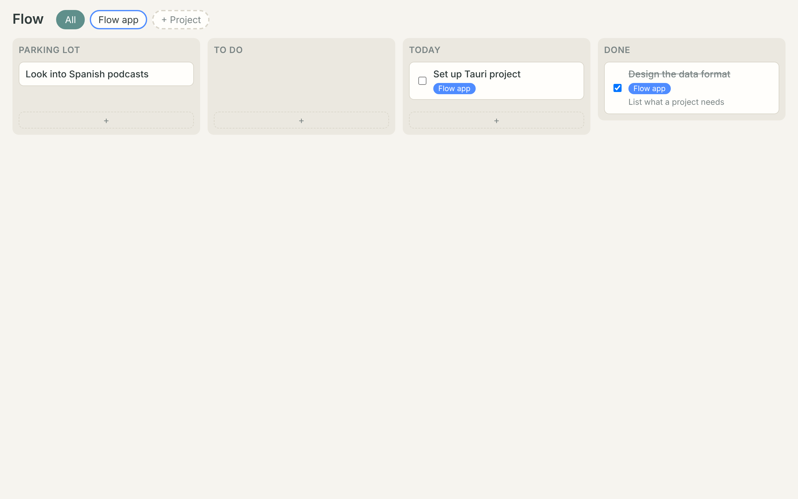

# Flow

Flow is a small desktop planner for one person. It has a single board with four columns:
**Parking lot** (loose thoughts), **To do**, **Today** (pick up to 3) and **Done**. You drag
cards between columns and tick them off. Everything you enter is stored as plain Markdown
files in a folder you choose, so you (or an AI assistant) can read and edit them any time.



## Run it on your computer

You only need to do the setup once.

1. Install the prerequisites for your system (Node.js, and on some systems Rust and a few
   system libraries). Follow the official list for your platform:
   https://v2.tauri.app/start/prerequisites/
2. Open a terminal in this project folder.
3. Install the project's packages (one time):
   ```
   npm install
   ```
4. Start Flow as a desktop app:
   ```
   npm run app:dev
   ```
   The first start takes a few minutes while it compiles. Later starts are quick.
5. On first launch Flow asks you to choose a folder. Pick (or create) an empty folder; Flow
   writes its files there.

To make an installable app instead of running from the terminal:
```
npx tauri build
```
The installer appears under `src-tauri/target/release/bundle/`.

To try the board quickly in a web browser (no desktop app; data lives only in memory and is
lost on reload), run `npm run dev` and open http://localhost:1420.

## What to check by hand

Automated tests cover the logic, and a browser smoke test (`node scripts/smoke.mjs`) covers
drag and drop, but these only work in the real desktop app:

- **Quick capture window:** press Ctrl+Shift+Space (Cmd+Shift+Space on Mac) from any app. A
  small window should appear; type a thought, press Enter, and it should land in the Parking
  lot. Escape closes it.
- **Choosing the folder:** on first launch pick a folder; close and reopen Flow and check it
  remembers the folder and shows your data.
- **Editing in a text editor:** with Flow open, edit a project file in the data folder with
  a text editor (for example change a task title) and save. Flow should show the change
  without a restart. A file with broken formatting is skipped and noted in `flow-issues.log`;
  Flow never overwrites it.

## What the data folder looks like

`inbox.md` (the Parking lot), `projects/<slug>.md` (one file per project, tasks in the YAML
header, free notes below), `days/YYYY-MM-DD.md` (what was planned and finished each day), a
`README.md` describing the format in full (Flow writes it on first run), and
`flow-issues.log` (files Flow could not read). Dates are YYYY-MM-DD in local time.

## Ask an AI about your week

Point an AI assistant at your Flow folder and try prompts like:

- Read the files in Flow/days from the last 7 days and give me honest feedback on my week.
- Look at my active projects in Flow/projects and suggest what I should plan for tomorrow.
